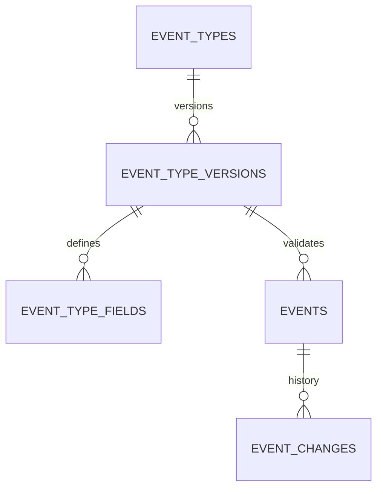

# Модель данных: исходное предложение

## Варианты хранения дополнительных полей

| Вариант | Преимущества | Ограничения |
| --- | --- | --- |
| Общие колонки события + значения в JSONB | Карточка читается целиком; новые поля не требуют DDL; можно хранить нативные JSON-числа и логические значения | Проверка по пользовательской схеме требует серверной логики; диапазоны и сортировка по произвольным полям требуют продуманной индексации |
| Типизированные строки значений: событие, поле, значение | Удобно проектировать общие индексы для чисел, дат и других типов; каждое значение адресуется отдельно | Больше строк и соединений; сложнее собирать карточку и запросы с несколькими фильтрами; нужны ограничения целостности для типов значений |
| Отдельная таблица для каждого типа события | Явная SQL-схема и ограничения типов | Пользовательские настройки приводят к DDL, сложнее общий поиск, миграции и управление правами |

Рабочая гипотеза: PostgreSQL, постоянные свойства в колонках, дополнительные
значения в JSONB. Источник технических свойств JSONB:
[из документации PostgreSQL](https://www.postgresql.org/docs/current/datatype-json.html).

## Основные сущности

| Сущность | Основные сведения | Назначение |
| --- | --- | --- |
| `event_types` | `id`, постоянный `code`, название | Идентичность типа события. |
| `event_type_versions` | `id`, `event_type_id`, `version`, статус | Конкретная версия настроек; предлагаемые статусы: черновик и опубликована |
| `event_type_fields` | `type_version_id`, `field_key`, название, `data_type`, обязательность, единица, варианты выбора, порядок | Определения полей конкретной версии |
| `events` | `id`, `well_id`, `type_version_id`, время или период, описание, `field_values`, `revision` | Карточка события и её текущие дополнительные значения |
| `event_changes` | `id`, `event_id`, версия записи, автор, время, изменения до/после, источник | История изменений |



является ли
`well_id` ссылкой на внешний справочник или на локальные данные(?)

## Правила, которые предлагается закрепить

1. Сочетание типа и номера его версии уникально. В пределах версии уникален
   `field_key`; однажды использованный ключ нельзя переиспользовать
2. Название поля можно менять независимо от ключа. Варианты выбора тоже имеют
   постоянные коды, отдельные от отображаемых названий
3. Опубликованная версия типа неизменяема. Новые настройки публикуются вместе с новой версией
4. Событие ссылается на конкретную опубликованную версию. Чтение, построение формы
   и проверка значений используют именно её
5. Добавление обязательного поля в новую версию не делает старые события невалидными.
   Перенос события на другую версию - операция с проверкой и записью в историю
6. Удаление поля из новой версии не удаляет определения и значения старых версий.
   Смена типа или единицы требует явного преобразования либо нового ключа поля
7. Сервер отклоняет неизвестные ключи и неверные типы значений
8. `revision` увеличивается при изменении события. Проверка ожидаемой версии, запись
   изменений и истории выполняются атомарно. Это главное для защиты от затирания правок

## Два примера

Значения и состав полей неокончательные

Тип `research`, версия 1:

| Ключ | Название | Тип | Обязательно | Единица / варианты |
| --- | --- | --- | --- | --- |
| `pressure` | Давление | число | да | бар |
| `temperature` | Температура | число | нет | °C |
| `method` | Метод исследования | выбор | да | `hydrodynamic`; `other` |

Значения в карточке исследования:

```json
{
  "pressure": 120.5,
  "temperature": 84,
  "method": "hydrodynamic"
}
```

Тип `shutdown`, версия 1:

| Ключ | Название | Тип | Обязательно | Варианты |
| --- | --- | --- | --- | --- |
| `reason` | Причина остановки | выбор | да | `repair`; `other` |
| `comment` | Комментарий | строка | нет | - |

Значения в карточке остановки:

```json
{
  "reason": "repair",
  "comment": "Плановая замена оборудования"
}
```

Обе карточки находятся в `events`; их `type_version_id` указывают на разные
определения полей. Проверки и элементы формы выбираются по этим определениям

## Поиск

- Базовые фильтры используют колонки события: скважина, тип через версию, время
- Для дополнительных полей API должно определять допустимые операции по типу поля.
  Числа сравниваются как числа; строки вариантов выбора сравниваются по постоянным кодам
- GIN подходит для определённых операций над JSONB, но не заменяет индексы
  для диапазонов и сортировки. Для востребованных полей можно будет оценить индексы
  на выражениях с безопасным приведением типов и ограничением по схеме
- Если нужны многочисленные произвольные числовые фильтры, сравнить JSONB
  с типизированным хранением значений на репрезентативных данных
- Определить семантику поиска по нескольким версиям типа, особенно при смене единиц
  и типов данных. Совпадение названий полей не означает совместимость значений

Механизм доставки:
[Transactional outbox - AWS Prescriptive Guidance](https://docs.aws.amazon.com/prescriptive-guidance/latest/cloud-design-patterns/transactional-outbox.html).
