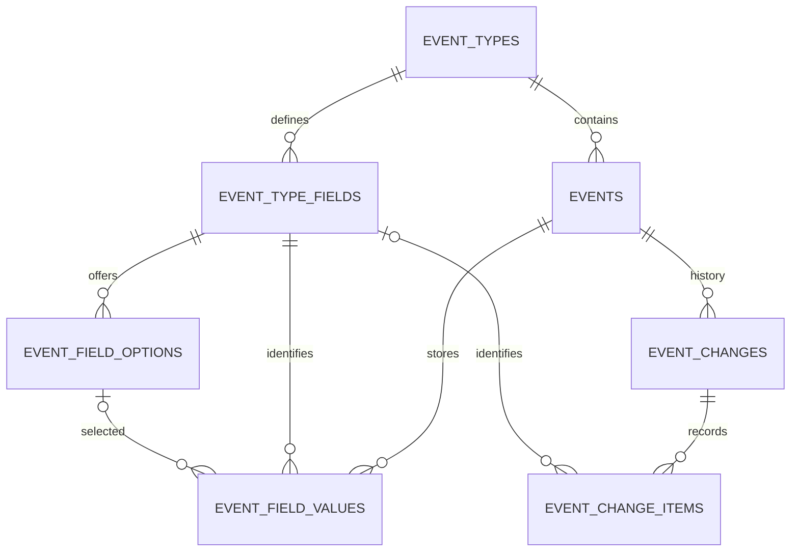

# Модель данных

У события есть тип, скважина, время и описание. Тип определяет дополнительные поля.
Пользователь создаёт тип и его поля добавлением записей в каталог. Структура таблиц
при этом остаётся общей для всех событий.

Например, «Исследование» содержит числовое поле «Давление» в барах, а «Остановка» —
поле «Причина» с выбором из справочника. Обе карточки хранятся в `events`.
Их дополнительные значения лежат в `event_field_values` по одному на строку.

| Событие | Тип | Поле | Колонка | Значение |
| --- | --- | --- | --- | --- |
| 101 | Исследование | `pressure` | `value_number` | 120,5 |
| 101 | Исследование | `temperature` | `value_number` | 84 |
| 102 | Остановка | `reason` | `value_option` | `repair` |

## Изменение полей

Для каждого типа действует один набор определений. Добавление необязательного поля
«Температура» сразу делает его доступным для заполнения. В карточке, где температуру
ещё не измеряли, строки значения нет. В карточке с измеренными нулём градусов
есть строка с числом `0`.

Чтобы сделать новое поле обязательным, сначала добавляем его необязательным.
Заполняем известные значения в готовых карточках, затем включаем обязательность.
Если корректные значения для старых карточек неизвестны, поле пока остаётся необязательным.
Массовое заполнение подтверждённым значением проходит через обычную запись истории.

Название поля можно исправить. Его технический ключ, тип данных и единица постоянны.
Если измерения переходят с бар на МПа, создаём новое поле и архивируем прежнее.
Старая карточка показывает сохранённое измерение вместе с его единицей. Так же
архивируются вышедшие из употребления варианты выбора.

## История карточки

`events.revision` увеличивается при правке карточки. Если пользователь поменял
давление, пока внешний обработчик читал файл, сервис обнаружит расхождение
с ожидаемой ревизией и сможет отправить предложение на проверку. История хранит
автора, время и отдельные изменения свойств. Правила записи описаны в
[детальной схеме](database-schema.md).



## Поиск

Запрос выбирает исследования скважины за январь с давлением выше 100 бар и сортирует
их по давлению. Дополнительное условие на другое поле можно добавить через `EXISTS`
по тому же событию.

```sql
SELECT e.id, e.started_at, v.value_number AS pressure_bar
FROM events e
JOIN event_types t ON t.id = e.event_type_id
JOIN event_field_values v ON v.event_id = e.id AND v.event_type_id = e.event_type_id
WHERE t.code = 'research' AND e.well_id = 'well-5'
  AND e.started_at >= '2026-01-01T00:00:00Z' AND e.started_at < '2026-02-01T00:00:00Z'
  AND v.field_key = 'pressure' AND v.value_number > 100
ORDER BY v.value_number DESC, e.id;
```

При показе формы сервис читает активные определения в порядке `sort_order, field_key`
и присоединяет сохранённые значения через `LEFT JOIN`. Для просмотра старой карточки
он также включает архивные определения, по которым у события есть значения.
