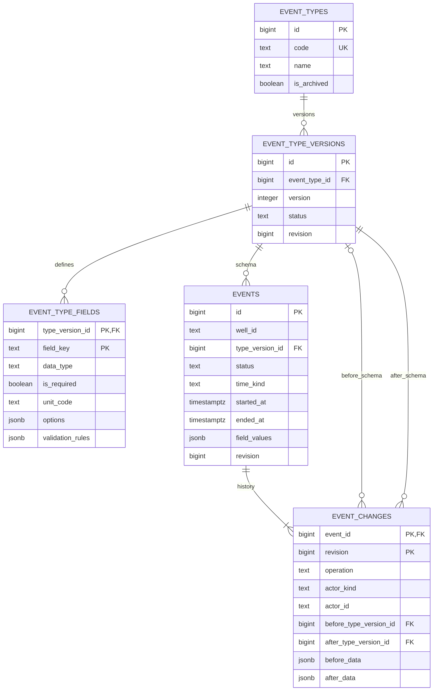

# Детальная схема основных таблиц

Статус: проект решения. Документ детализирует [исходную модель](data-model.md);
SQL-миграции и приложение пока не реализованы. Выбранные правила поведения
предлагаются для согласования, а не считаются дополнительными требованиями заказчика.

На этом шаге описываются пять таблиц для типов, полей, событий и истории карточки.
Модель файлов, предложений обработчика, происхождения отдельных значений,
подписок и outbox будет добавлена следующим этапом.

## Общие соглашения и предположения

- Данные записывает один сервис в одну PostgreSQL. Для самостоятельных сущностей
  выбирается `bigint GENERATED ALWAYS AS IDENTITY` вместе с `PRIMARY KEY`
- Пока предполагается одно общее пространство типов и событий. Если нужны независимые
  организации с одинаковыми кодами типов и изоляцией данных, до реализации следует
  добавить границы владения и пересмотреть уникальность и составные внешние ключи
- В таблицах ниже «нет» в колонке NULL означает `NOT NULL`. Значение по умолчанию
  само по себе не заменяет это ограничение
- Человек и программа задаются парой `actor_kind` / `actor_id` либо аналогичными
  колонками с префиксом. Вид автора: `user` или `service`; идентификатор непустой
  `text` из системы авторизации. Автор определяется сервером по аутентификации,
  а не принимается на доверии из тела запроса
- Время хранится в `timestamptz`. API принимает время с часовым поясом; для выдачи
  можно использовать UTC. PostgreSQL сохраняет момент времени, но не исходное
  название часового пояса. Часовой пояс отображения будет настройкой интерфейса.
- Для времени создания используется `now()`. Колонки `updated_at` обновляются
  при записи: наличие DEFAULT не обновляет их автоматически.
- `code` и `field_key`: постоянные коды по шаблону `^[a-z][a-z0-9_]{0,63}$`
- Все внешние ключи ниже предполагают `ON DELETE RESTRICT`, `ON UPDATE RESTRICT`.
  Идентификаторы не изменяются. Архивирование типа не удаляет события и историю

## 1. event_types

| Колонка | Тип | NULL | По умолчанию | Назначение / ограничение |
| --- | --- | --- | --- | --- |
| `id` | `bigint` | нет | identity | Первичный ключ |
| `code` | `text` | нет | - | Уникальный постоянный код, например `research` |
| `name` | `text` | нет | - | Название типа; `btrim(name) <> ''` |
| `description` | `text` | да | NULL | Описание назначения типа |
| `is_archived` | `boolean` | нет | `false` | Архивный тип недоступен для создания новых событий |
| `created_at` | `timestamptz` | нет | `now()` | Время создания |
| `updated_at` | `timestamptz` | нет | `now()` | Время последнего изменения записи каталога |
| `created_by_kind` | `text` | нет | - | `user` или `service` |
| `created_by_id` | `text` | нет | - | Идентификатор создателя |

Ключи: `PRIMARY KEY (id)`, `UNIQUE (code)`. Код остаётся занятым после архивирования.
Название относится к текущему каталогу

## 2. event_type_versions

| Колонка | Тип | NULL | По умолчанию | Назначение / ограничение |
| --- | --- | --- | --- | --- |
| `id` | `bigint` | нет | identity | Первичный ключ |
| `event_type_id` | `bigint` | нет |  | FK -> `event_types.id` |
| `version` | `integer` | нет | - | Номер версии внутри типа, `version >= 1` |
| `status` | `text` | нет | `draft` | `draft` или `published` |
| `revision` | `bigint` | нет | `1` | Счётчик правок черновика схемы, `revision >= 1` |
| `created_at` | `timestamptz` | нет | `now()` | Создание версии |
| `updated_at` | `timestamptz` | нет | `now()` | Последнее изменение версии или её полей |
| `created_by_kind` | `text` | нет | - | `user` или `service` |
| `created_by_id` | `text` | нет | - | Создатель черновика |
| `published_at` | `timestamptz` | да | NULL | Время публикации |
| `published_by_kind` | `text` | да | NULL | `user` или `service` |
| `published_by_id` | `text` | да | NULL | Автор публикации |

Ключи: `PRIMARY KEY (id)`, `UNIQUE (event_type_id, version)`.
Частичный уникальный индекс по `event_type_id WHERE status = 'draft'` допускает
один редактируемый черновик на один тип

CHECK для состояния публикации: у `draft` все три `published_*` равны SQL NULL;
у `published` все три заполнены

`version` - номер схемы, `revision` - номер правки её черновика. Это будут разные счётчики.
Опубликованная версия и её поля неизменяемы. Для следующей версии копируются поля
предыдущей версии в новый черновик. Номер назначается в транзакции вместе с блокировкой записи типа;
ограничение UNIQUE дополнительно защищает от совпадения номеров

Текущая версия по умолчанию - опубликованная с наибольшим `version`.
Событие всегда сохраняет конкретный `type_version_id`; публикация новой схемы
не меняет эту ссылку у существующих событий

## 3. event_type_fields

| Колонка | Тип | NULL | По умолчанию | Назначение / ограничение |
| --- | --- | --- | --- | --- |
| `type_version_id` | `bigint` | нет | - | FK -> `event_type_versions.id` |
| `field_key` | `text` | нет | - | Постоянный код поля внутри типа |
| `label` | `text` | нет | - | Название поля; `btrim(label) <> ''` |
| `description` | `text` | да | NULL | Подсказка для заполнения |
| `data_type` | `text` | нет | - | Один из типов, перечисленных ниже |
| `is_required` | `boolean` | нет | `false` | Обязательно для готового события |
| `unit_code` | `text` | да | NULL | Постоянное обозначение единицы, например `bar`; только для числовых типов |
| `options` | `jsonb` | да | NULL | Массив вариантов для `select`; для остальных типов SQL NULL |
| `validation_rules` | `jsonb` | нет | `{}` | JSON-объект с разрешёнными правилами для данного типа |
| `sort_order` | `integer` | нет | `0` | Порядок в форме, `sort_order >= 0` |

Первичный ключ: `(type_version_id, field_key)`. Отдельный искусственный `id` не нужен:
значения в событии адресуются по `field_key`, а его определения - по версии схемы.
Порядок формы стабилен: `sort_order`, затем `field_key`

Начальный набор типов полей:

| `data_type` | Представление в JSON | Проверка значения / допустимые правила |
| --- | --- | --- |
| `text` | Строка | `min_length`, `max_length`: целые неотрицательные границы длины |
| `integer` | Число без дробной части | `min`, `max`: целочисленные границы |
| `number` | Число | `min`, `max`: десятичные границы. Сервер обрабатывает числа без неявного округления |
| `boolean` | `true` или `false` | Дополнительных правил пока нет |
| `date` | Строка `YYYY-MM-DD` | Реальная календарная дата. Дополнительных правил пока нет |
| `datetime` | Строка RFC 3339 со смещением или `Z` | Реальный момент времени; нормализуется в UTC |
| `select` | Строка с кодом варианта | Код присутствует в `options`; выбор одного варианта |

Пример `options`:

```json
[
  { "code": "hydrodynamic", "label": "Гидродинамический" },
  { "code": "other", "label": "Другой" }
]
```

Пример `validation_rules` для `number`:

```json
{ "min": 0, "max": 1000 }
```

CHECK проверяет допустимые `data_type`, объект в `validation_rules`, допустимость
`unit_code` (SQL NULL либо непустая строка при типе `integer` или `number`)
и форму `options`: для `select` это непустой JSON-массив, иначе SQL NULL.
Функции над массивом вызываются только в соответствующей ветке CASE, чтобы неверный
JSON-тип давал отказ проверки, а не ошибку вычисления длины массива.
Сервер дополнительно проверяет структуру вариантов, уникальность и непустоту кодов,
непустые названия, допустимые ключи правил и согласованность границ (`min <= max`)

### Идентичность поля между версиями

Одинаковый `field_key` в версиях одного типа означает одинаковый смысл, тип данных
и единицу измерения. Название, обязательность и ограничения можно менять публикацией новой версии.
Для смены типа данных или единицы создаётся новый ключ; при миграции события значения
преобразуются явно. Автоматического пересчёта единиц нет.

## 4. events - карточки событий

| Колонка | Тип | NULL | По умолчанию | Назначение / ограничение |
| --- | --- | --- | --- | --- |
| `id` | `bigint` | нет | identity | Первичный ключ |
| `well_id` | `text` | нет | - | Непустой идентификатор скважины |
| `type_version_id` | `bigint` | нет | - | FK -> `event_type_versions.id` |
| `status` | `text` | нет | `draft` | `draft` или `ready`; характеризует заполнение карточки |
| `time_kind` | `text` | нет | - | `instant` или `period` |
| `started_at` | `timestamptz` | нет | - | Момент события либо начало периода |
| `ended_at` | `timestamptz` | да | NULL | Конец периода |
| `description` | `text` | нет | Пустая строка | Описание события |
| `field_values` | `jsonb` | нет | `{}` | Значения дополнительных полей; только JSON-объект |
| `revision` | `bigint` | нет | `1` | Номер состояния карточки, `revision >= 1` |
| `created_at` | `timestamptz` | нет | `now()` | Время создания записи |
| `updated_at` | `timestamptz` | нет | `now()` | Время последнего изменения |
| `created_by_kind` | `text` | нет | - | `user` или `service` |
| `created_by_id` | `text` | нет | - | Автор создания |


### Заполнение и проверка

- Ключ отсутствует в `field_values` - значение ещё не задано. JSON `null` для значения
  поля отклоняется
- В `draft` обязательные дополнительные поля могут отсутствовать. Это позволяет
  создать событие, прикрепить Excel и дождаться обработки. Все уже переданные значения
  проверяются по типам и ограничениям; базовые колонки также остаются обязательными
- В `ready` заполнены все обязательные поля. Обязательный текст не может состоять
  только из пробелов; `0` и `false` считаются заполненными значениями
- Любое редактирование `ready` сохраняет валидность. Для очистки обязательного поля
  нужно явно вернуть карточку в `draft` той же операцией. Автоматического понижения
  статуса нет. После заполнения черновика переход в `ready` тоже явный
- Неизвестные ключи, неверные типы и недопустимые значения отклоняются. Число `120`
  не заменяется строкой `"120"`; выбор хранится кодом, а не названием
- Схема проверяется по сохранённому `type_version_id`, даже если опубликована новая.
  При создании выбирается последняя опубликованная версия по умолчанию; явный запрос
  может указать другую опубликованную версию того же неархивного типа
- Переход к другой версии того же типа - отдельная операция миграции с полной
  проверкой итоговой карточки и сохранением снимка старых данных. Смена самого типа
  события в этой модели не разрешается

FK подтверждает существование версии. Опубликованность версии,
архивность типа, допустимость JSON-полей и заполненность для `ready` проверяет сервер.

## 5. event_changes

| Колонка | Тип | NULL | По умолчанию | Назначение / ограничение |
| --- | --- | --- | --- | --- |
| `event_id` | `bigint` | нет | - | FK -> `events.id`. |
| `revision` | `bigint` | нет | - | Версия карточки после изменения; `revision >= 1`. |
| `operation` | `text` | нет | - | `created`, `updated` или `schema_migrated`. |
| `actor_kind` | `text` | нет | - | `user` или `service`. |
| `actor_id` | `text` | нет | - | Непустой идентификатор автора изменения. |
| `changed_at` | `timestamptz` | нет | `now()` | Серверное время изменения. |
| `before_type_version_id` | `bigint` | да | NULL | FK -> `event_type_versions.id`; схема до изменения. |
| `after_type_version_id` | `bigint` | нет | - | FK ->F `event_type_versions.id`; схема после изменения. |
| `before_data` | `jsonb` | да | NULL | Полный снимок бизнес-данных до изменения. |
| `after_data` | `jsonb` | нет | - | Полный снимок бизнес-данных после изменения. |

Первичный ключ: `(event_id, revision)`. У создания `revision = 1`, `operation = 'created'`,
`before_data` и `before_type_version_id` равны SQL NULL. У остальных записей
`revision > 1`, старый снимок и старая версия заполнены. Это проверяется CHECK.
Снимки - JSON-объекты; JSON `null` и массивы недопустимы.

Для `updated` версии схемы до и после равны; для `schema_migrated` различаются.
При миграции сервер дополнительно проверяет принадлежность обеих версий одному типу.
Отдельные FK на старую и новую схемы сохраняют ссылки на определения полей даже после
того, как все текущие карточки были перенесены на новую версию.

В каждый снимок входят `well_id`, `status`, `time_kind`, `started_at`, `ended_at`,
`description`, `field_values`. Версии схемы находятся в отдельных FK-колонках,
а не дублируются в JSON. Время в снимке записывается строкой RFC 3339 в UTC;
отсутствующий конец периода - JSON `null`. Это правило для снимков базовых колонок
не меняет запрет JSON `null` внутри `field_values`.

## Связи



## Индексы

| Таблица | Индекс / ограничение | Зачем |
| --- | --- | --- |
| Все таблицы | Индексы первичных ключей | Адресация строк. |
| `event_types` | UNIQUE `(code)` | Поиск типа по коду и запрет дублей. |
| `event_type_versions` | UNIQUE `(event_type_id, version)` | Версии конкретного типа; покрывает FK по `event_type_id`. |
| `event_type_versions` | UNIQUE `(event_type_id)` WHERE `status = 'draft'` | Один черновик схемы на тип. |
| `event_type_fields` | PK `(type_version_id, field_key)` | Все поля версии; дополнительный индекс на FK не нужен. |
| `events` | `(well_id, started_at DESC, id DESC)` | Лента событий скважины и диапазон времени начала. |
| `events` | `(type_version_id, started_at DESC, id DESC)` | События версии схемы; индекс на FK. |
| `event_changes` | PK `(event_id, revision)` | История события; индекс на FK по событию. |
| `event_changes` | `(before_type_version_id)` WHERE `before_type_version_id IS NOT NULL` | Ссылки истории на старые схемы. |
| `event_changes` | `(after_type_version_id)` | Ссылки истории на итоговые схемы. |

## Транзакции и границы проверок

БД обеспечивает типы колонок, NOT NULL, PK, FK, UNIQUE и перечисленные CHECK.
Проверки, зависящие от содержимого других таблиц, выполняет сервис в транзакции:
обычный CHECK не должен читать определения полей из соседней таблицы.
Интеграции записывают данные через API, а не напрямую в таблицы.

1. **Изменение черновика типа.** Заблокировать запись типа, затем версии; проверить
   `status = 'draft'` и ожидаемый `revision`. Изменить поля, увеличить `revision`,
   обновить `updated_at`. Все операции редактирования и публикации используют тот
   же порядок блокировок
2. **Публикация.** Под теми же блокировками проверить определения полей, правила,
   варианты выбора и совместимость ключей с прежними версиями. Проставить статус,
   автора и время публикации
3. **Создание события.** Заблокировать запись типа, проверить архивность и выбранную
   опубликованную схему. Проверить карточку, вставить `events` с `revision = 1`
   и запись `event_changes` с тем же номером. Зафиксировать их вместе.
   Архивирование типа берёт ту же блокировку, чтобы не было рейса с созданием
4. **Изменение события.** Заблокировать событие, проверить ожидаемый `revision`,
   проверить итоговые данные по его схеме и статусу. При совпадении версий обновить
   карточку и записать историю с `revision + 1` одной транзакцией. При несовпадении
   вернуть конфликт без изменения данных. Одинаковое итоговое состояние не создаёт
   новую ревизию. Поздний ответ обработчика проходит ту же проверку; обработка
   конфликта будет частью модели предложений значений
5. **Миграция схемы события.** Заблокировать событие, проверить ожидаемый `revision`,
   опубликованность целевой версии и принадлежность прежнему типу. Проверить итоговую
   карточку, сохранить обе схемы и снимки в истории. Перенос не должен молча терять
   данные: отсутствующие в новой схеме поля остаются доступны в старом снимке.

После добавления уведомлений запись outbox будет входить в ту же транзакцию,
что событие и его история
